# Module ORM

## Status

- Type: minor module
- Value: 1 point
- Status: valid
- Subject: database schema modeled and accessed through an ORM
- ORM: Prisma
- Database: PostgreSQL
- Schema file: `web/prisma/schema.prisma`
- Prisma helper: `web/src/lib/prisma.ts`

This module documents the database structure used by the web application. The
schema is declared with Prisma, then mapped to PostgreSQL tables through
explicit model definitions, relations, constraints, indexes, and enums.

## Database Structure

The application database is centered on users, financial assets, watchlists,
analysis results, reports, notifications, API keys, and user activity events.

```mermaid
erDiagram
    USERS ||--o{ WATCHLISTS : owns
    WATCHLISTS ||--o{ WATCHLIST_ITEMS : contains
    ASSETS ||--o{ WATCHLIST_ITEMS : appears_in

    USERS ||--o{ ANALYSES : requests
    ASSETS ||--o{ ANALYSES : analyzed_as
    ANALYSES ||--o{ ANALYSIS_SOURCES : uses

    USERS ||--o{ REPORTS : owns
    ASSETS ||--o{ REPORTS : describes
    ANALYSES |o--o{ REPORTS : optional_source

    USERS ||--o{ NOTIFICATIONS : receives
    USERS ||--o| API_KEYS : owns
    USERS ||--o{ USER_EVENTS : generates
    ASSETS |o--o{ USER_EVENTS : optional_context

    USERS {
        string id PK
        string email UK
        string oauthProvider
        string oauthProviderAccountId
        string passwordHash
        string displayName
        string_array favoriteSymbols
        Role role
        datetime bannedAt
        datetime createdAt
        datetime updatedAt
    }

    ASSETS {
        string id PK
        string symbol UK
        string name
        float lastPrice
        float dayChange
        float dayChangePercent
        datetime dataFetchedAt
        datetime fetchAttemptedAt
        datetime createdAt
        datetime updatedAt
    }

    WATCHLISTS {
        string id PK
        string userId FK
        string name
        datetime createdAt
        datetime updatedAt
    }

    WATCHLIST_ITEMS {
        string id PK
        string watchlistId FK
        string assetId FK
        datetime createdAt
    }

    ANALYSES {
        string id PK
        string userId FK
        string assetId FK
        AnalysisStatus status
        string horizon
        TrendLabel trendLabel
        RecommendationLabel recommendation
        float technicalScore
        float emotionScore
        float confidenceScore
        string summary
        string error
        datetime startedAt
        datetime completedAt
        datetime createdAt
        datetime updatedAt
    }

    ANALYSIS_SOURCES {
        string id PK
        string analysisId FK
        SourceKind kind
        string url
        string title
        string excerpt
        datetime publishedAt
        json rawPayload
        datetime createdAt
    }

    REPORTS {
        string id PK
        string userId FK
        string assetId FK
        string analysisId FK
        string title
        string summary
        string content
        json metadata
        datetime createdAt
        datetime updatedAt
    }

    NOTIFICATIONS {
        string id PK
        string userId FK
        NotificationType type
        string entityType
        string entityId
        string title
        string body
        datetime readAt
        datetime createdAt
        datetime updatedAt
    }

    API_KEYS {
        string id PK
        string userId FK
        string name
        string keyHash UK
        string prefix
        datetime lastUsedAt
        datetime revokedAt
        datetime createdAt
        datetime updatedAt
    }

    USER_EVENTS {
        string id PK
        string userId FK
        string assetId FK
        UserEventType type
        json metadata
        datetime createdAt
    }

    APP_SETTINGS {
        string key PK
        string value
        datetime updatedAt
    }
```

Relationship legend:

- `||--o{` means one row can own zero or many related rows.
- `||--o|` means one row can own zero or one related row.
- `|o--o{` means the relation is optional on one side and can have many rows
  on the other side.
- `FK` means foreign key.
- `PK` means primary key.
- `UK` means unique key.

## Tables and Relationships

| Prisma model | SQL table | Main role | Main relationships |
|---|---|---|---|
| `User` | `users` | Application account, profile, role, OAuth identity, favorites | Owns analyses, watchlists, notifications, API keys, events, and reports |
| `Asset` | `assets` | Financial instrument available to search, analyze, and watch | Linked to analyses, watchlist items, reports, and optional events |
| `Watchlist` | `watchlists` | Named list owned by one user | Belongs to one user; owns watchlist items |
| `WatchlistItem` | `watchlist_items` | Join table between watchlists and assets | Belongs to one watchlist and one asset |
| `Analysis` | `analyses` | Stored analysis request/result for one user and one asset | Belongs to user and asset; owns analysis sources; can be referenced by reports |
| `AnalysisSource` | `analysis_sources` | Source material attached to an analysis | Belongs to one analysis |
| `Report` | `reports` | Generated report content for one user and one asset | Belongs to user and asset; optionally references an analysis |
| `Notification` | `notifications` | Persistent user notification | Belongs to one user |
| `ApiKey` | `api_keys` | Hashed API key for public API access | Belongs to one user |
| `UserEvent` | `user_events` | Auditable user activity | Belongs to one user; optionally references an asset |
| `AppSetting` | `app_settings` | Application key-value setting | Standalone table |

## Key Fields and Data Types

### `users`

| Field | Type | Notes |
|---|---|---|
| `id` | `String` / UUID | Primary key |
| `email` | `String` | Unique account email |
| `oauthProvider` | `String?` | OAuth provider name, nullable |
| `oauthProviderAccountId` | `String?` | OAuth account id, nullable |
| `passwordHash` | `String?` | Password hash for credential login, nullable |
| `displayName` | `String?` | Public profile name |
| `avatarUrl` | `String?` | Stored avatar reference |
| `avatarMimeType` | `String?` | Avatar MIME type |
| `avatarSize` | `Int?` | Avatar file size |
| `avatarScale` | `Float` | Avatar crop scale, default `1` |
| `avatarOffsetX` | `Float` | Avatar crop X offset, default `0` |
| `avatarOffsetY` | `Float` | Avatar crop Y offset, default `0` |
| `favoriteSymbols` | `String[]` | PostgreSQL text array of favorite asset symbols |
| `role` | `Role` enum | `USER`, `ADMIN`, or `ANALYST`; default `USER` |
| `bannedAt` | `DateTime?` | Ban timestamp, nullable |
| `createdAt` | `DateTime` | Creation timestamp |
| `updatedAt` | `DateTime` | Auto-updated timestamp |

Important constraints:

- `email` is unique.
- `(oauthProvider, oauthProviderAccountId)` is unique.
- Indexed by `email`, `role`, and `bannedAt`.

### `assets`

| Field | Type | Notes |
|---|---|---|
| `id` | `String` / UUID | Primary key |
| `symbol` | `String` | Unique asset ticker or symbol |
| `name` | `String?` | Human-readable asset name |
| `lastPrice` | `Float?` | Latest stored price |
| `dayChange` | `Float?` | Absolute daily variation |
| `dayChangePercent` | `Float?` | Percent daily variation |
| `dataFetchedAt` | `DateTime?` | Last successful data fetch |
| `fetchAttemptedAt` | `DateTime?` | Last attempted fetch |
| `createdAt` | `DateTime` | Creation timestamp |
| `updatedAt` | `DateTime` | Auto-updated timestamp |

Important constraints:

- `symbol` is unique.
- Indexed by `symbol`, `name`, and `createdAt`.

### `watchlists`

| Field | Type | Notes |
|---|---|---|
| `id` | `String` / UUID | Primary key |
| `userId` | `String` / UUID | Foreign key to `users.id` |
| `name` | `String` | Watchlist name, default `Default` |
| `createdAt` | `DateTime` | Creation timestamp |
| `updatedAt` | `DateTime` | Auto-updated timestamp |

Relationship and constraints:

- `userId` references `users.id`.
- Deleting a user deletes their watchlists.
- `(userId, name)` is unique so one user cannot have duplicate watchlist names.
- Indexed by `userId` and `createdAt`.

### `watchlist_items`

| Field | Type | Notes |
|---|---|---|
| `id` | `String` / UUID | Primary key |
| `watchlistId` | `String` / UUID | Foreign key to `watchlists.id` |
| `assetId` | `String` / UUID | Foreign key to `assets.id` |
| `createdAt` | `DateTime` | Creation timestamp |

Relationship and constraints:

- `watchlistId` references `watchlists.id`.
- `assetId` references `assets.id`.
- Deleting a watchlist or asset deletes the related watchlist item.
- `(watchlistId, assetId)` is unique so the same asset cannot appear twice in
  the same watchlist.
- Indexed by `watchlistId`, `assetId`, and `createdAt`.

### `analyses`

| Field | Type | Notes |
|---|---|---|
| `id` | `String` / UUID | Primary key |
| `userId` | `String` / UUID | Foreign key to `users.id` |
| `assetId` | `String` / UUID | Foreign key to `assets.id` |
| `status` | `AnalysisStatus` enum | `QUEUED`, `RUNNING`, `SUCCEEDED`, or `FAILED`; default `QUEUED` |
| `horizon` | `String` | Analysis horizon, default `short` |
| `trendLabel` | `TrendLabel?` enum | `BULLISH`, `NEUTRAL`, or `BEARISH` |
| `recommendation` | `RecommendationLabel?` enum | `BUY`, `HOLD`, `SELL`, or `WATCH` |
| `technicalScore` | `Float?` | Numeric technical score |
| `emotionScore` | `Float?` | Numeric sentiment/emotion score |
| `confidenceScore` | `Float?` | Numeric confidence score |
| `summary` | `String?` | Human-readable result summary |
| `error` | `String?` | Failure detail |
| `startedAt` | `DateTime?` | Processing start timestamp |
| `completedAt` | `DateTime?` | Processing completion timestamp |
| `createdAt` | `DateTime` | Creation timestamp |
| `updatedAt` | `DateTime` | Auto-updated timestamp |

Relationship and constraints:

- `userId` references `users.id`.
- `assetId` references `assets.id`.
- Deleting a user or asset deletes related analyses.
- Indexed by `userId`, `assetId`, `status`, `trendLabel`, `recommendation`,
  and `createdAt`.

### `analysis_sources`

| Field | Type | Notes |
|---|---|---|
| `id` | `String` / UUID | Primary key |
| `analysisId` | `String` / UUID | Foreign key to `analyses.id` |
| `kind` | `SourceKind` enum | `PRICE`, `COMMENT`, `NEWS`, `API`, or `SCRAPE` |
| `url` | `String?` | Source URL |
| `title` | `String?` | Source title |
| `excerpt` | `String?` | Extracted text |
| `publishedAt` | `DateTime?` | Source publication timestamp |
| `rawPayload` | `Json?` | Original structured source payload |
| `createdAt` | `DateTime` | Creation timestamp |

Relationship and constraints:

- `analysisId` references `analyses.id`.
- Deleting an analysis deletes its sources.
- Indexed by `analysisId`, `kind`, `publishedAt`, and `createdAt`.

### `reports`

| Field | Type | Notes |
|---|---|---|
| `id` | `String` / UUID | Primary key |
| `userId` | `String` / UUID | Foreign key to `users.id` |
| `assetId` | `String` / UUID | Foreign key to `assets.id` |
| `analysisId` | `String?` / UUID | Optional foreign key to `analyses.id` |
| `title` | `String` | Report title |
| `summary` | `String?` | Short report summary |
| `content` | `String?` | Full report body |
| `metadata` | `Json?` | Structured report metadata |
| `createdAt` | `DateTime` | Creation timestamp |
| `updatedAt` | `DateTime` | Auto-updated timestamp |

Relationship and constraints:

- `userId` references `users.id`.
- `assetId` references `assets.id`.
- `analysisId` optionally references `analyses.id`.
- Deleting a user or asset deletes related reports.
- Deleting an analysis keeps the report and sets `analysisId` to `null`.
- Indexed by `userId`, `assetId`, `analysisId`, and `createdAt`.

### `notifications`

| Field | Type | Notes |
|---|---|---|
| `id` | `String` / UUID | Primary key |
| `userId` | `String` / UUID | Foreign key to `users.id` |
| `type` | `NotificationType` enum | Notification category |
| `entityType` | `String?` | Related object type, for example `watchlist` |
| `entityId` | `String?` | Related object identifier |
| `title` | `String` | Notification title |
| `body` | `String?` | Notification body |
| `readAt` | `DateTime?` | Read timestamp, nullable while unread |
| `createdAt` | `DateTime` | Creation timestamp |
| `updatedAt` | `DateTime` | Auto-updated timestamp |

Relationship and constraints:

- `userId` references `users.id`.
- Deleting a user deletes their notifications.
- Indexed by `userId`, `type`, `readAt`, and `createdAt`.

### `api_keys`

| Field | Type | Notes |
|---|---|---|
| `id` | `String` / UUID | Primary key |
| `userId` | `String` / UUID | Foreign key to `users.id`; unique |
| `name` | `String` | Display name for the key |
| `keyHash` | `String` | Unique hash of the secret API key |
| `prefix` | `String` | Short visible prefix used for lookup/display |
| `lastUsedAt` | `DateTime?` | Last successful use |
| `revokedAt` | `DateTime?` | Revocation timestamp |
| `createdAt` | `DateTime` | Creation timestamp |
| `updatedAt` | `DateTime` | Auto-updated timestamp |

Relationship and constraints:

- `userId` references `users.id`.
- Deleting a user deletes their API key.
- `userId` is unique, so each user has at most one API key row.
- `keyHash` is unique.
- Indexed by `userId`, `prefix`, `revokedAt`, and `createdAt`.

### `user_events`

| Field | Type | Notes |
|---|---|---|
| `id` | `String` / UUID | Primary key |
| `userId` | `String` / UUID | Foreign key to `users.id` |
| `assetId` | `String?` / UUID | Optional foreign key to `assets.id` |
| `type` | `UserEventType` enum | Activity category |
| `metadata` | `Json?` | Structured event payload |
| `createdAt` | `DateTime` | Creation timestamp |

Relationship and constraints:

- `userId` references `users.id`.
- `assetId` optionally references `assets.id`.
- Deleting a user deletes their events.
- Deleting an asset keeps the event and sets `assetId` to `null`.
- Indexed by `userId`, `assetId`, `type`, and `createdAt`.

### `app_settings`

| Field | Type | Notes |
|---|---|---|
| `key` | `String` | Primary key |
| `value` | `String` | Stored setting value |
| `updatedAt` | `DateTime` | Auto-updated timestamp |

This table is independent from the user and asset graph.

## Enum Types

| Enum | Values |
|---|---|
| `Role` | `USER`, `ADMIN`, `ANALYST` |
| `AnalysisStatus` | `QUEUED`, `RUNNING`, `SUCCEEDED`, `FAILED` |
| `TrendLabel` | `BULLISH`, `NEUTRAL`, `BEARISH` |
| `RecommendationLabel` | `BUY`, `HOLD`, `SELL`, `WATCH` |
| `SourceKind` | `PRICE`, `COMMENT`, `NEWS`, `API`, `SCRAPE` |
| `NotificationType` | `WATCHLIST_CREATED`, `WATCHLIST_UPDATED`, `WATCHLIST_DELETED`, `ANALYSIS_CREATED`, `ANALYSIS_UPDATED`, `ANALYSIS_FAILED`, `API_KEY_CREATED`, `API_KEY_REVOKED`, `EXPORT_READY`, `SYSTEM` |
| `UserEventType` | `LOGIN`, `SEARCH`, `VIEW_ASSET`, `VIEW_REPORT`, `ADD_WATCHLIST_ITEM`, `REMOVE_WATCHLIST_ITEM`, `FAVORITE_ASSET`, `EXPORT`, `CLICK_SOURCE` |

## Cascade and Nullable Relation Rules

The schema defines deletion behavior directly in the ORM relations.

| Relation | Delete behavior |
|---|---|
| `User -> Watchlist` | Cascade |
| `User -> Analysis` | Cascade |
| `User -> Report` | Cascade |
| `User -> Notification` | Cascade |
| `User -> ApiKey` | Cascade |
| `User -> UserEvent` | Cascade |
| `Asset -> WatchlistItem` | Cascade |
| `Asset -> Analysis` | Cascade |
| `Asset -> Report` | Cascade |
| `Asset -> UserEvent` | Set `assetId` to `null` |
| `Watchlist -> WatchlistItem` | Cascade |
| `Analysis -> AnalysisSource` | Cascade |
| `Analysis -> Report` | Set `analysisId` to `null` |

This gives the database predictable ownership rules: private user-owned data is
removed with the user, join rows are removed with their parent entities, and
historical reports or events can survive when their optional context is deleted.

## Note About Reports

The `reports` table is part of the Prisma schema even though the current
application only exposes it through the analyst dashboard report count. It is
kept in the schema as a forward-compatible table for a future implementation of
generated analysis reports.

The existing relationships already define the intended ownership model:

- a report belongs to one user;
- a report describes one asset;
- a report can optionally reference the analysis that produced it;
- if the referenced analysis is deleted, the report can remain available with
  `analysisId` set to `null`.

This allows a future report-generation feature to store durable report content
without changing the main user, asset, and analysis relationship model.
